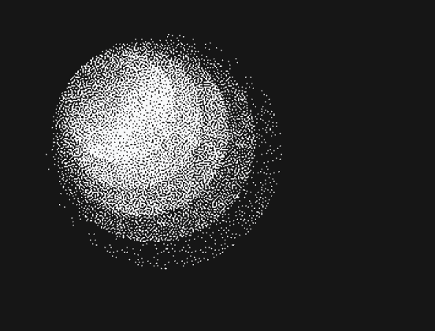

# Focus Orb

A dithered, glowing particle sphere that visualizes focus time and upcoming meetings. The orb is dense and bright during focus blocks and slowly scatters as your next meeting approaches.



## Features

- **Particle Visualization**: 8,000 stippled white dots on a dark (#161616) background with soft breathing motion
- **Calendar Integration**: Connect to Google Calendar via private iCal URL (stored locally, never on server)
- **Scatter Effect**: Orb density changes based on time to next meeting (0 = tight/bright, 1 = scattered/dim)
- **Manual Focus Blocks**: Start 25, 50, or 90-minute focus sessions without a calendar
- **Configurable Scatter Window**: Choose when the orb starts scattering (15/30/60/90 minutes before meeting)
- **Demo Mode**: View the full scatter animation cycle with `?demo=1` query parameter
- **Tab Title & Favicon**: Live countdown indicator for pinned tabs
- **Keyboard Shortcuts**:
  - `f` - Toggle fullscreen
  - `s` - Open settings
  - `space` - Start/stop manual focus block

## Getting Started

### Prerequisites

- Node.js 20+ and npm

### Installation & Running Locally

1. Clone the repository and install dependencies:

```bash
npm install
```

2. Run the development server:

```bash
npm run dev
```

3. Open [http://localhost:3000](http://localhost:3000) in your browser

The app will start with no calendar connected. To connect your Google Calendar, follow the steps below.

### Connecting Google Calendar

To sync with your Google Calendar:

1. Open Google Calendar in your browser
2. Go to **Settings** (gear icon) → **Settings**
3. In the left sidebar, click on the calendar you want to connect
4. Scroll down to **Integrate calendar**
5. Copy the **Secret address in iCal format** URL (it should look like `https://calendar.google.com/calendar/ical/...`)
6. In Focus Orb, press `s` to open settings
7. Paste the iCal URL and click Save

**Important**: This URL is stored locally in your browser's localStorage only. It is never logged or persisted on the server. The API route at `/api/calendar` only proxies the fetch to avoid CORS issues.

### Manual Focus Blocks

To use Focus Orb without a calendar:

1. Press `s` to open settings
2. Click one of the manual focus block buttons (25m, 50m, or 90m)
3. The orb will start dense and bright, then scatter in the final portion of your focus block
4. Press `space` to stop the focus block early

### Demo Mode

To see the scatter effect in action without waiting for a meeting:

```
http://localhost:3000?demo=1
```

This cycles the scatter value from 0 to 1 over 60 seconds.

## Building for Production

```bash
npm run build
```

The build output is ready to deploy to Vercel or any Node.js hosting platform.

## Running Tests

```bash
npm test
```

Tests cover:
- Scatter calculation logic with various time windows
- ICS parsing including recurring events and all-day events
- Calendar event expansion and filtering
- Time formatting utilities

## Technical Details

- **Framework**: Next.js 16 (App Router) with TypeScript
- **Rendering**: Canvas 2D API for particle visualization
- **Calendar**: Standard iCalendar (ICS) format with RRULE support
- **Storage**: Client-side only (localStorage)
- **Styling**: Tailwind CSS

## Architecture

- `/app` - Next.js app routes
  - `/api/calendar` - ICS proxy endpoint (calendar URL never persisted)
- `/components` - React components
  - `Orb.tsx` - Main particle sphere with state management
  - `Settings.tsx` - Settings panel UI
  - `Overlay.tsx` - Text overlay for event info
- `/lib` - Core logic
  - `scatter.ts` - Scatter calculation with ease-in curve
  - `calendar.ts` - ICS parsing and event expansion
  - `useCalendar.ts` - Calendar state management hook
  - `useManualFocus.ts` - Manual focus session hook
  - `useTabTitle.ts` - Tab title/favicon updates

## Privacy & Security

- Calendar URLs are stored in localStorage only (client-side)
- The API route proxies calendar fetches but never logs or persists URLs
- No server-side storage or external analytics
- No authentication required

## License

MIT
