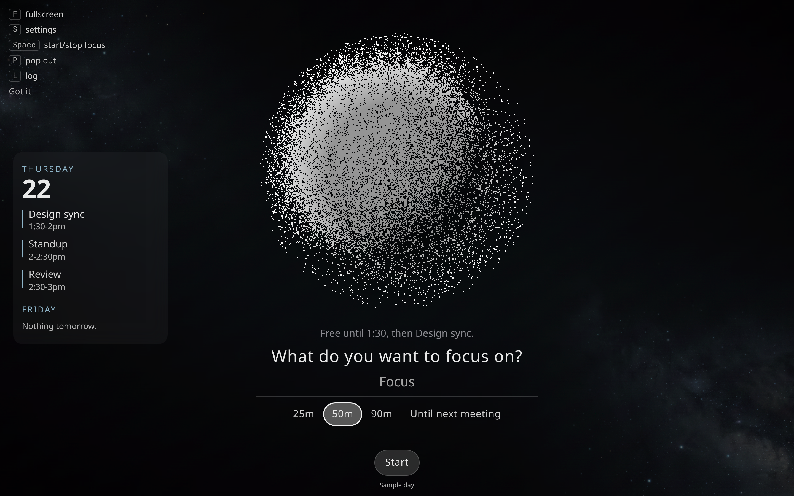
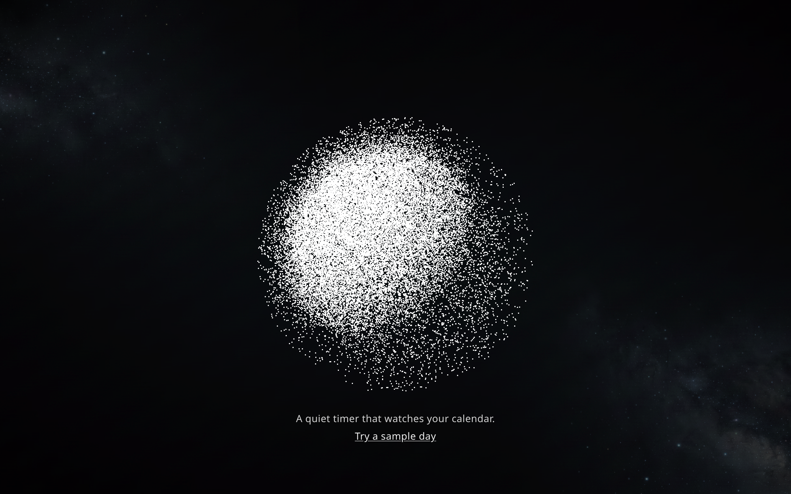
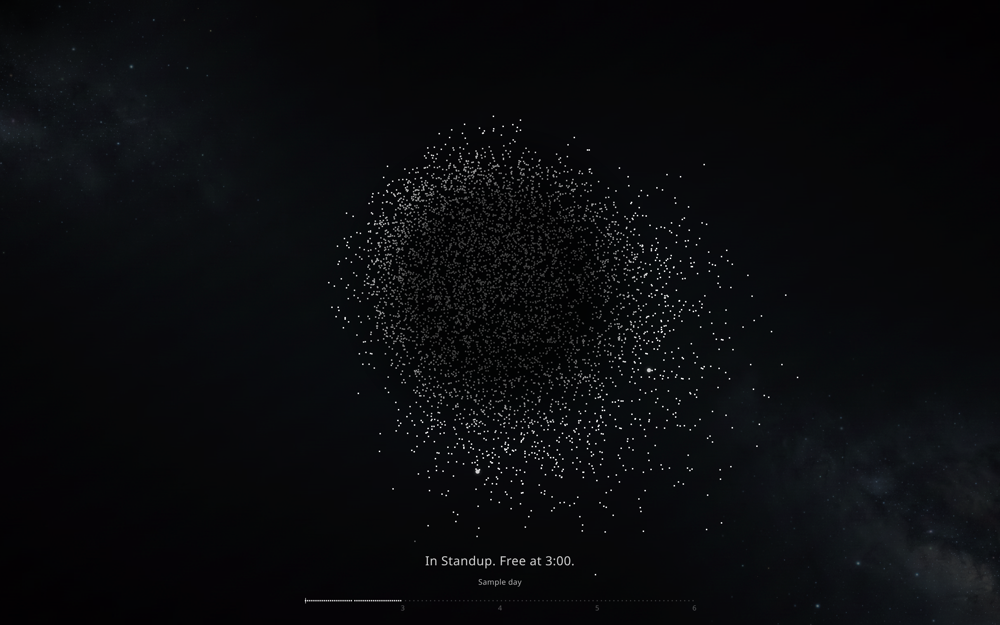

# Focus Orb

Focus Orb helps creatives protect their best hours by sizing deep-work blocks to their calendar and WHOOP recovery.

**Live demo:** [https://focus-orb-one.vercel.app](https://focus-orb-one.vercel.app)

## Features

- **Particle orb visualization** - A glowing sphere of 8,000 particles that stays cohesive during focus blocks and scatters as your next meeting approaches
- **Google Calendar integration** - View your agenda and let the orb respond to your schedule in real-time
- **WHOOP-aware block suggestions** - Duration recommendations based on your recovery score (when WHOOP is connected)
- **Focus log** - Track your completed focus sessions
- **Keyboard shortcuts** - Fast navigation with `f` (fullscreen), `s` (settings), `space` (start/stop), and more
- **Sample day mode** - Try the app without connecting a calendar

## Screenshots

### Focus State


### Sample Day Demo


### Meeting State


## Stack

- **Next.js 16** (App Router) with TypeScript
- **Canvas particle rendering** for the orb visualization
- **NextAuth** for Google sign-in
- **WHOOP API** for recovery-based suggestions
- **Vitest** for unit tests, **Playwright** for E2E tests
- Deployed on **Vercel**

## Running Locally

1. Install dependencies:
```bash
npm install
```

2. Copy the example environment file:
```bash
cp .env.example .env
```

3. Start the dev server:
```bash
npm run dev
```

4. Open [http://localhost:3000](http://localhost:3000)

### Mock Calendars

Try these URLs to see different states without connecting a calendar:

- `?mock=back-to-back&now=12:00` - Dense schedule
- `?mock=light&now=12:00` - Relaxed schedule
- `?mock=sample-day` - Full sample day

Click "Try a sample day" on the home page for an interactive demo.
